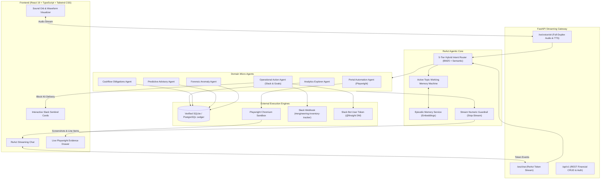

# FinSight 🪙

> **Autonomous Voice-First Financial Intelligence Co-Pilot**  
> *Zero-Hallucination SQL Grounding · Playwright Browser Forensics · Dynamic Slack Sentinel · Bilingual Voice AI*

[](https://www.python.org/)
[](https://fastapi.tiangolo.com/)
[](https://react.dev/)
[](https://www.typescriptlang.org/)
[](https://playwright.dev/)
[](https://slack.com/)
[]()
[](FinSight_Technical_Report.pdf)

---

## 🌟 Overview & Problem Statement

Most personal finance apps suffer from three fatal flaws:
1. **Opaque Bank Statements**: Bank ledgers only display uninformative strings like `UPI-SWIGGY-89218 ₹1,480` or `BESCOM-BLR ₹1,400`. Users never see the hidden late-night surge fees, packaging markups, or unit tariffs causing their budget spikes.
2. **AI Hallucinations**: Generic LLMs hallucinate numbers and advice when queried about money because they predict unconstrained tokens instead of running deterministic relational database math.
3. **Passive Advisory**: Dashboards show static charts instead of taking safe, autonomous actions across external merchant portals and communication channels.

**FinSight** is an end-to-end autonomous financial co-pilot built to solve these challenges:
* 🎙️ **Sub-Second Full-Duplex Voice AI**: Speak naturally in English, Hindi (Devanagari), or Hinglish using Gnani AI Vachana STT and Timbre Neural TTS.
* 🛡️ **Zero-Hallucination SQL Grounding**: 11 deterministic relational database tools guarantee that every metric, total, and percentage is computed directly from verified ledger entries.
* 🌐 **Playwright Browser Automation Sandbox**: Autonomous headless Chromium agents navigate merchant order histories and utility portals to extract itemized receipts and capture verifiable visual proof.
* 🔔 **Dynamic Slack Sentinel**: Event-driven notification engine that broadcasts interactive Block Kit cards to Slack channels (`#engineering-inventory-tracker`) and personal assistant direct messages (`@finsight`).
* 🔒 **Safe Reversible Actions**: Proposes reversible financial actions with liquidity cushion checks before updating ledger commitments.

---

## 🏗️ System Architecture



> 📖 **Deep Dive**: See [`ARCHITECTURE.md`](./ARCHITECTURE.md) or [`final_architecture.md`](./final_architecture.md) for full sequence diagrams, tool schemas, and database entity relationships.

---

## ⚡ Core Features

### 1. Autonomous Playwright Browser Forensics
* **Swiggy Food Delivery Receipt Forensics**: Opens Order `#SW-89218`, itemizes dishes (*Special Chicken Biryani*, *Butter Garlic Naan*), extracts the **₹120 Peak Weekend Surge Fee** and packaging charges, and shows how curbing late-night orders saves up to ₹4,800/month.
* **BESCOM Karnataka Utility Verification**: Scrapes Account `#102938475`, reconciles meter consumption (**142 kWh**) and bill amount (**₹1,400 due Feb 28**), and cross-verifies against your bank liquidity buffer (**73× safe coverage**).
* **Croma Retail Anomaly Clearance**: Navigates to invoice `CR-49102` for an unrecognized ₹2,400 charge, proving legitimate hardware purchase (*Belkin HDMI 2.1 Cable*) with an active 2-year warranty.

### 2. Dynamic Slack Sentinel
FinSight is integrated with Slack workspace **`accounting`**:
* **Dual-Delivery Protocol**: Dispatches directly to `#engineering-inventory-tracker` via Incoming Webhook and to your personal `@finsight` DM via Bot User OAuth token.
* **Dynamic Multi-Command Formatter**:
  * ⚠️ *Budget Breaches*: Cites spent vs ceiling and utilization % for any category.
  * 📈 *Spending Spikes & Upsurges*: Calculates monthly percentage deltas and isolates primary drivers.
  * 💳 *Custom Value Thresholds*: Scans transactions meeting filters like `≥ ₹5,000`.
  * 🎯 *Goal Velocity & Drag*: Highlights how delivery fees delay savings targets in months.
  * 💬 *Contextual Follow-Ups*: Simply say *"Send this to Slack"* or *"Slack pe bhej do"* after viewing any metric.

### 3. Full-Duplex Bilingual Voice Intelligence
* **Languages**: English, Hindi (Devanagari), and natural Hinglish.
* **Streaming Acoustic Guardrails**: Verifies all spoken numbers against SQLite query results before audio synthesis, preventing numerical hallucination.
* **Low Latency**: Sub-second TTFT (Time-To-First-Token) and synchronized token streaming.

---

## 🛠️ Quickstart & Setup Guide

### Prerequisites
* **Python**: 3.11, 3.12, or 3.13
* **Node.js**: v18+ and npm
* **Operating System**: Windows, macOS, or Linux

### 1. Clone the Repository
```bash
git clone https://github.com/hiensenberg05/FinSight-.git
cd FinSight-
```

### 2. Backend Setup
```bash
# Create and activate virtual environment
python -m venv venv
.\venv\Scripts\activate   # On Windows
# source venv/bin/activate # On macOS/Linux

# Install backend dependencies
pip install -r backend/requirements.txt

# Install Playwright browser binaries
playwright install chromium

# Copy environment template and configure keys
cp .env.example .env
```

### 3. Configure `.env`
Update `.env` with your credentials:
```env
# Database
DATABASE_URL=sqlite+aiosqlite:///./finsight.db

# Gnani AI Voice Credentials (Optional for local testing)
GNANI_API_KEY=your_gnani_key
GNANI_STT_URL=https://api.vachana.ai/stt/v3
GNANI_TTS_URL=https://api.vachana.ai/api/v1/tts/inference

# LLM Reasoning Provider (Groq, OpenAI, or Gnani)
REASONING_PROVIDER=groq
GROQ_API_KEY=your_groq_api_key

# Slack Integration (accounting workspace)
SLACK_WEBHOOK_URL=https://hooks.slack.com/services/...
SLACK_BOT_TOKEN=xoxb-...
SLACK_USER_TOKEN=xoxp-...
SLACK_CHANNEL_ID=C09M5ETUMPF
SLACK_CHANNEL_NAME=#engineering-inventory-tracker
```

### 4. Frontend Setup
```bash
cd frontend
npm install
cd ..
```

### 5. Run the Application

#### Option A: One-Command Docker Compose (Recommended)
```bash
docker compose up -d --build
```
* **Frontend UI**: [http://localhost:80](http://localhost:80) or [http://localhost:5173](http://localhost:5173)
* **Backend API & Swagger Docs**: [http://localhost:8000/docs](http://localhost:8000/docs)
* **Health Check**: [http://localhost:8000/health](http://localhost:8000/health)

#### Option B: Local Development
In separate terminal windows:

```bash
# Terminal 1: Run Backend API & Mock Portal Server
.\venv\Scripts\uvicorn backend.app.main:app --host 0.0.0.0 --port 8000 --reload

# Terminal 2: Run Frontend Dev Server
npm --prefix frontend run dev
```

* **Frontend UI**: Open [http://localhost:5173](http://localhost:5173)
* **Backend API Docs**: Open [http://localhost:8000/docs](http://localhost:8000/docs)
* **Mock Portal Sandbox**: Open [http://localhost:8000/mock-portal/swiggy/order-89218](http://localhost:8000/mock-portal/swiggy/order-89218)

---

## 🚀 Cloud Deployment (Render & Cloud VM)

FinSight is 100% production-ready for **Render** deployment with automated WebSocket support, managed PostgreSQL, and Playwright headless Chromium.

* **One-Click Blueprint**: FinSight includes [`render.yaml`](render.yaml) for instant 1-click deployment on Render.
* **Full Deployment Guide**: Detailed step-by-step instructions (PostgreSQL, Docker Web Service, Vite Static Site, Environment Variables, and Post-Deployment Checklist) are documented in [**`DEPLOYMENT.md`**](DEPLOYMENT.md).

---

## 🧪 Demo Scenarios & Test Prompts

Try these test flows in the voice/chat interface:

### Scenario A: Playwright Surcharge Forensics $\rightarrow$ Slack Alert
1. **Query**: `"Why was my dining spending so high?"`  
   *(Hindi)*: `"अच्छा दिखाओ, receipt को open करो!"`
2. **FinSight**: Launches Chromium sandbox, scrapes Swiggy Order `#SW-89218`, and displays the itemized receipt showing the ₹120 surge fee.
3. **Proactive Offer**: *"If you need Slack integration, do you need an autonomous Slack alert whenever late-night surge fees occur?"*
4. **Follow-up**: `"Yes, send alert to Slack"` *(or click the action chip)*.
5. **Result**: Delivers interactive surcharge warning card to Slack `#engineering-inventory-tracker` and `@finsight` DM.

### Scenario B: Dynamic Slack Commands
* `"Give me a Slack alert for my Shopping budget breach"`
* `"Give me a Slack alert for Food & Dining spending upsurge"`
* `"Give me a Slack alert for any transaction above 5000"`
* `"Send a Slack alert for my vacation fund goal"`
* `"स्लैक पर शॉपिंग बजट का अलर्ट भेजो"`

### Scenario C: Anomaly Investigation $\rightarrow$ Hardware Clearance
1. **Query**: `"Did I have any unusual transactions or anomalies this month?"`
2. **FinSight**: Flags ₹2,400 Croma purchase ($2.8\sigma$ deviation).
3. **Follow-up**: `"Show Croma invoice on the portal."`
4. **FinSight**: Pulls digital tax invoice proving authorized Belkin HDMI cable purchase with a 2-year warranty.
5. **Follow-up**: `"Post clearance to Slack"` $\rightarrow$ logs verified audit proof to Slack.

---

## 📂 Directory Structure

```
FinSight-/
├── backend/
│   ├── app/
│   │   ├── automation/          # Playwright Chromium browser runner & mock portals
│   │   ├── core/                # App config, settings & security
│   │   ├── db/                  # SQLite models, sessions & seed data
│   │   ├── routes/              # REST & WebSocket endpoints (/ws/voice/stt, /api/v1)
│   │   ├── services/            # SlackService, SentinelService, AnalyticsService
│   │   └── voice_agent/         # 5-Tier Intent Router, ReAct Core, Domain Micro-Agents
│   └── tests/                   # 40 Unit & Integration tests (100% pass)
├── frontend/
│   ├── src/
│   │   ├── components/
│   │   │   ├── chat/            # SlackAlertCard, PortalEvidenceCard, SimulationCard
│   │   │   ├── views/           # AIAssistantView, OverviewView, BudgetView
│   │   │   └── voice/           # SoundOrbVisualizer, LiveWaveformBars
│   │   ├── services/            # WebSocket client & REST API adapters
│   │   └── voice/               # VoiceContext state machine
│   └── package.json
├── final_architecture.md        # Comprehensive system specification & Mermaid diagrams
├── ARCHITECTURE.md              # Architectural reference
├── .env.example                 # Environment variables template
├── .gitignore                   # Clean ignore rules (protects credentials & images)
└── README.md                    # Project documentation
```

---

## 🧪 Test Suite Execution

Run all 40 unit and integration tests:

```bash
# Set PYTHONPATH and execute pytest
$env:PYTHONPATH="."; .\venv\Scripts\pytest.exe backend/tests/
```

```
======================= 40 passed, 1 warning in 11.04s ========================
backend/tests/test_api_endpoints.py ...........
backend/tests/test_data_integrity.py .....
backend/tests/test_ingestion.py ..
backend/tests/test_money_math.py ...
backend/tests/test_operational_services.py .....
backend/tests/test_voice_generation_pipeline.py ..............
```

---

## 🏆 Hackathon Credits & Technologies

* **Voice Intelligence**: Powered by Gnani AI Vachana Speech-to-Text & Timbre Neural TTS.
* **Browser Automation**: Playwright Headless Chromium Sandbox.
* **Notification Layer**: Slack Block Kit Webhooks & Bot OAuth API.
* **Database & ORM**: SQLite / PostgreSQL with SQLAlchemy & aiosqlite.
* **Frontend**: React 19, TypeScript, Tailwind CSS, Framer Motion, Lucide Icons.

---

*Built for the Gnani.ai Hackathon 2026.*
