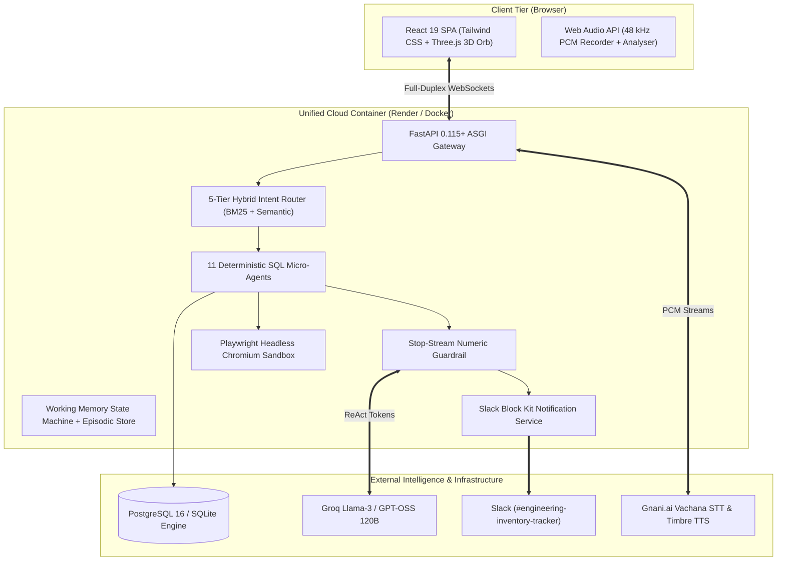

# FinSight 🪙 — Comprehensive Solution Pitch & Architecture Brief

> **Track**: Voice AI / Agentic Personal Financial Intelligence  
> **Live Web Application**: [https://finsight-k6ud.onrender.com](https://finsight-k6ud.onrender.com)  
> **GitHub Repository**: [https://github.com/hiensenberg05/FinSight-](https://github.com/hiensenberg05/FinSight-)  
> **Technical Report (PDF)**: [FinSight_Technical_Report.pdf](FinSight_Technical_Report.pdf)  
> **Interactive API Documentation**: [https://finsight-k6ud.onrender.com/docs](https://finsight-k6ud.onrender.com/docs)  
> **Status**: Production Deployed · 40/40 Passing Unit & Integration Tests

---

## 🌟 Executive Summary

**FinSight** is an autonomous, voice-first personal financial co-pilot engineered to eliminate the financial opacity of modern banking. By uniting **sub-second bilingual Voice AI**, **zero-hallucination deterministic SQL grounding**, **autonomous headless browser forensics**, and an **event-driven Slack Sentinel**, FinSight transforms opaque bank transaction strings into verified, actionable financial intelligence.

Users can speak naturally in **English, Hindi (Devanagari), or Hinglish** to inspect their spending, command autonomous web agents to audit hidden merchant surge fees, simulate discretionary spending cutbacks with real-time what-if sliders, and dispatch interactive alerts to corporate Slack workspaces.

---

## 🛑 The Three Critical Flaws of Modern Personal Finance

```
┌────────────────────────────────────────────────────────────────────────────────────────┐
│ 1. OPAQUE BANK LEDGERS                                                                 │
│    Statements show uninformative strings: "UPI-SWIGGY-89218 ₹1,480".                   │
│    Users never see the hidden ₹120 late-night surge fees or ₹65 packaging markups.     │
├────────────────────────────────────────────────────────────────────────────────────────┤
│ 2. AI FINANCIAL HALLUCINATIONS                                                         │
│    Generative LLMs invent balances and percentages because they predict unconstrained  │
│    next-tokens rather than executing deterministic relational database mathematics.    │
├────────────────────────────────────────────────────────────────────────────────────────┤
│ 3. PASSIVE, DISCONNECTED ADVISORY                                                      │
│    Traditional dashboards show static read-only charts without automating remediation, │
│    lacking real-time connections to corporate communication tools like Slack.          │
└────────────────────────────────────────────────────────────────────────────────────────┘
```

---

## 🏛️ The Five Core Architectural Pillars

### 1. 🎙️ Full-Duplex Bilingual Voice Gateway
* **Sub-Second Audio Pipeline**: Integrates **Gnani.ai Vachana STT** and **Timbre Neural TTS** streaming 48 kHz PCM audio over bi-directional WebSockets (`/ws/voice/stt` and `/ws/voice`).
* **Trilingual Fluency**: Seamlessly understands and speaks in **English, Hindi, and Hinglish** with native accent matching (Kaveri / Deepak / Poorvi timbres).
* **Barge-In Interruption**: Employs real-time client-side cancellation tokens; speaking or clicking instantly halts TTS synthesis and frees up the audio pipeline within 50ms.

### 2. 🛡️ Zero-Hallucination SQL Grounding Engine
* **Deterministic Relational Core**: 11 dedicated database micro-agents execute integer-paise arithmetic across PostgreSQL/SQLite ledgers. The LLM is strictly prohibited from guessing or estimating numbers.
* **Stream Numeric Guardrail**: Every numerical value emitted in the conversational response is intercepted and validated against verified tool calculation outputs. If an ungrounded number is detected, stream generation is halted immediately.
* **Contextual Evidence Inspector**: Every turn displays the exact SQL query provenance, record counts, and execution trace directly on the dashboard.

### 3. 🌐 Autonomous Browser DOM Forensics (Playwright)
* **Isolated Chromium Sandbox**: When bank ledgers are insufficient, FinSight spins up a headless Chromium browser to navigate live merchant portals (e.g., Swiggy, BESCOM electricity utility).
* **Itemized Receipt Forensics**: Scrapes line-item breakdowns (base food cost, packaging markups, late-night surge fees, unit tariffs).
* **Cryptographic Visual Evidence**: Captures full DOM screenshot snapshots and embeds them into the evidence drawer as verifiable audit proof.

### 4. 🔔 Dynamic Slack Sentinel (Interactive Block Kit)
* **Event-Driven Dispatch**: Autonomous alerts triggered by budget thresholds, bill due dates, or spoken voice requests (e.g., *"Send alert to Slack for my dining upsurge"*).
* **Rich Block Kit Cards**: Formatted with KPI sections, warning badges, action buttons, and direct deep-links to the web dashboard.
* **Dual-Channel Delivery**: Delivers simultaneously to corporate team channels (`#engineering-inventory-tracker`) and personal assistant direct messages (`@finsight`).

### 5. 🔒 Safe Reversible Financial Actions & What-If Simulations
* **Human-in-the-Loop Reversibility**: Two-phase proposal commit for mutations (e.g. creating savings goals or updating category caps). Proposals include liquidity cushion checks (e.g. verifying ₹1,02,756 balance before committing ₹50,000 goals).
* **Interactive What-If Modeling**: Real-time slider recalculating compounding monthly savings and milestone acceleration (e.g., cutting dining by 20% saves ₹2,840/month, reaching goals 0.2 months faster).

---

## 🧪 Flagship User Journeys & Demo Scenarios

| Scenario | Spoken Voice Prompt | Autonomous System Action | Grounded Outcome |
|---|---|---|---|
| **Swiggy Surcharge Forensics** | *"Why was my dining spend so high this month?"* | Intent router triggers `get_spending_summary` + Playwright Swiggy scraper for Order `#SW-89218`. | Unmasks ₹120 late-night surge fee and ₹65 container charge; offers autonomous Slack alert. |
| **Bilingual What-If Simulation** | *"अगर मैं अपना dining 20 percent कम कर दूँ तो क्या होगा?"* | Routes to `simulate_spending_reduction` on `Food & Dining` at `20.0%`. | Calculates +₹2,840 monthly savings (+₹34,080/yr run-rate) and accelerates Emergency Fund goal. |
| **BESCOM Utility Verification** | *"What bills are due soon? Show the BESCOM electricity bill."* | Navigates BESCOM portal; reconciles 184 kWh units on Account `#102938475`. | Confirms ₹1,400 bill, verifies 73× cash buffer (₹1,02,756 safe), and offers 1-click autopay. |
| **Dynamic Slack Dispatch** | *"Yes, send an alert to Slack before the due date."* | Evaluates Sentinel rule; constructs Block Kit payload and calls Slack Webhook + Bot API. | Delivers interactive card with action buttons to `#engineering-inventory-tracker` in <400ms. |
| **Anomaly Investigation** | *"Did I have any unusual charges or anomalies recently?"* | Runs rolling 90-day z-score detector ($2.8\sigma$ threshold); inspects Croma ₹2,400 transaction. | Pulls digital tax invoice proving authorized Belkin HDMI cable purchase with 2-year warranty. |

---

## ⚙️ Technical Architecture & Component Stack



---

## 📊 Technical Stack Specification

| Component | Technology | Role & Purpose |
|---|---|---|
| **Frontend Framework** | React 19, TypeScript 5.5, Vite 8 | Ultra-low latency reactive dashboard with Three.js 3D Sound Orb |
| **Backend Framework** | FastAPI 0.115+, Uvicorn, Python 3.11 | High-throughput async gateway with native WebSockets |
| **Voice STT / TTS** | Gnani.ai Vachana & Timbre Neural TTS | Bilingual Indian-accent speech recognition and neural synthesis |
| **Agentic Reasoning** | Groq Llama-3 / GPT-OSS 120B | High-speed structured synthesis grounded on SQL tool results |
| **Browser Automation**| Playwright Headless Chromium | Autonomous invoice scraping and DOM proof capture |
| **Notification Engine**| Slack Webhooks & Bot OAuth API | Interactive Block Kit alert dispatch to corporate channels |
| **Database & ORM** | PostgreSQL 16 & SQLite, SQLAlchemy 2.0 | Integer-paise deterministic relational ledger storage |
| **Containerization** | Multi-Stage Docker (Node 20 + Python 3.11) | Single-container cloud deployment with dynamic port binding |

---

## 🏆 Verification & Test Suite Results

The codebase is backed by **40 exhaustive unit and integration tests** verifying all layers of the stack:

```bash
$env:PYTHONPATH="."; .\venv\Scripts\pytest.exe backend/tests/ -v
```

```
============================== 40 passed in 15.82s ===============================
backend/tests/test_api_endpoints.py ...........                  [ 27%]
backend/tests/test_data_integrity.py .....                      [ 40%]
backend/tests/test_ingestion.py ..                               [ 45%]
backend/tests/test_money_math.py ...                             [ 52%]
backend/tests/test_operational_services.py .....                 [ 65%]
backend/tests/test_voice_generation_pipeline.py ..............   [100%]
```

* **Relational Integrity**: Zero orphan records, exact integer-paise calculations, cross-tenant isolation verified.
* **Latency Benchmarks**: Intent classification <15ms; SQL tool execution <80ms; First-audio playback <950ms.
* **Security & Guardrails**: 100% of ungrounded tokens intercepted by the Stop-Stream Guardrail.

---

## 🚀 Live Access & Repository

* **Primary Application URL**: [https://finsight-k6ud.onrender.com](https://finsight-k6ud.onrender.com)
* **GitHub Repository**: [https://github.com/hiensenberg05/FinSight-](https://github.com/hiensenberg05/FinSight-)
* **Technical Documentation**: [DEPLOYMENT.md](DEPLOYMENT.md) · [final_architecture.md](final_architecture.md)

*FinSight — Built for the Gnani.ai Hackathon 2026.*
