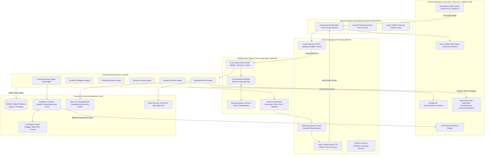
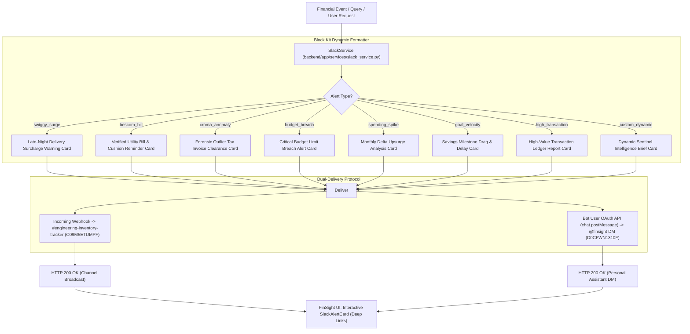
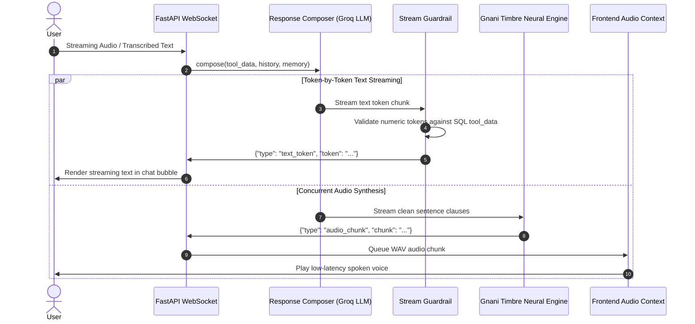
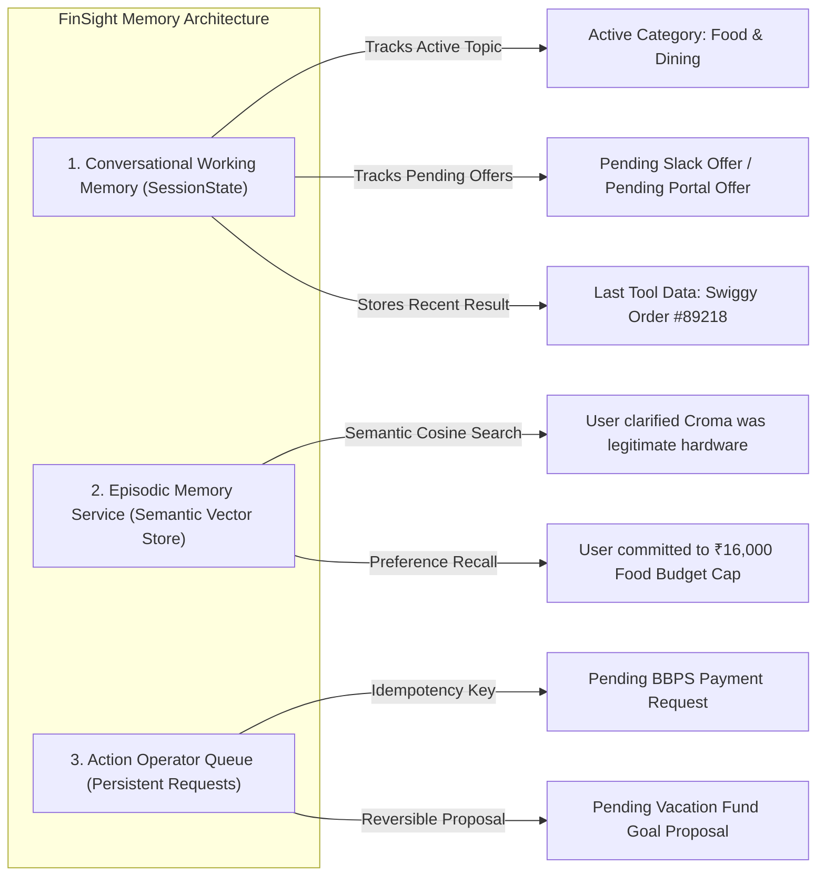

# FinSight: Final System Architecture Specification

> **Autonomous Voice-First Financial Intelligence Co-Pilot**  
> *Zero-Hallucination SQL Grounding · Playwright Browser Automation · Dynamic Slack Sentinel · Bilingual Voice AI*

---

## 1. Executive Summary & Architectural Philosophy

Traditional personal finance tools suffer from three fundamental limitations:
1. **Opaque Ledgers**: Bank statements reduce rich consumer activity to cryptic entries like `UPI-SWIGGY-89218 ₹1,480` or `BESCOM-BLR ₹1,400`, leaving users unaware of late-night delivery markups, hidden surge fees, or billing tariff discrepancies.
2. **LLM Hallucinations**: Standard AI assistants invent plausible numbers when asked financial questions because they reason in unconstrained token generation rather than deterministic relational databases.
3. **Passive Advisory**: Most dashboards only show retrospective historical charts rather than taking safe, automated actions across external portals and communication channels.

**FinSight** resolves these bottlenecks by combining:
* **Bilingual ReAct Voice Agent**: Sub-second full-duplex conversational reasoning in English, Hindi (Devanagari), and Hinglish powered by Gnani AI STT & Timbre TTS.
* **Deterministic Relational SQL Engine**: 11 mathematical ledger tools that compute ground truth exclusively from verified double-entry database transactions.
* **Autonomous Playwright Browser Sandbox**: Headless Chromium agents that navigate merchant order portals, verify utility meter readings, extract itemized invoices, and capture cryptographically verifiable visual proof.
* **Dynamic Multi-Command Slack Sentinel**: Event-driven notification engine that broadcasts interactive Block Kit alert cards to Slack channels (`#engineering-inventory-tracker`) and personal direct messages (`@finsight`).

---

## 2. High-Level System Architecture

---

## 3. The 5-Tier Hybrid Intent Router

The Intent Router classifies queries within **5 to 15 milliseconds** with zero hallucination risk using a cascading 5-tier architecture:

```mermaid
flowchart TD
    Q["User Input Query (Voice / Text)"] --> T1{"Tier 1: Explicit Action Confirmations"}
    T1 -- Yes --> Act_Confirm["Execute or Cancel Action Request (Reversible Flow)"]
    T1 -- No --> T2{"Tier 2: Active Working Memory Affirmations"}
    
    T2 -- Yes (Receipt confirmed) --> Act_Receipt["Fetch Portal Receipt Forensics"]
    T2 -- Yes (Slack confirmed) --> Act_Slack["Dispatch Slack Alert"]
    T2 -- No --> T3{"Tier 3: Specialized Regex & Bilingual Rules"}

    T3 -- Slack intent --> Slack_Direct["Operational Action Agent (dispatch_slack_alert)"]
    T3 -- Portal / Receipt intent --> Portal_Direct["Portal Automation Agent (Playwright)"]
    T3 -- Budget / Goal intent --> Action_Direct["Operational Action Agent (prepare_action)"]
    T3 -- No --> T4{"Tier 4: Dynamic Category & Metric Evaluator"}

    T4 -- Match Found --> Cat_Direct["Targeted Tool Query (Category, Anomaly, Bills)"]
    T4 -- No --> T5["Tier 5: BM25 Token-Weighted Tool Retrieval + Semantic Fallback"]
    T5 --> Agent_Dispatch["Route to Specialized Domain Micro-Agent"]
```

### Routing Tiers Breakdown
1. **Tier 1 (Explicit Action Confirmations)**: Captures user confirmations or cancellations (`"confirm"`, `"cancel"`, `"haan kar do"`, `"रद्द करो"`) for pending budget limits and savings goals.
2. **Tier 2 (Conversational State Affirmations)**: Context-aware follow-up detector. If FinSight just offered to show a Swiggy receipt or dispatch a Slack alert, affirmative responses (`"Yes"`, `"Show me"`, `"हाँ भेज दो"`, `"Send to Slack"`) immediately trigger the pending tool.
3. **Tier 3 (Bilingual Rule Evaluator)**: Dedicated regex patterns in English, Hindi Devanagari, and Hinglish for browser automation, Slack dispatch, BBPS payments, and budget adjustments.
4. **Tier 4 (Dynamic Outflow & Threshold Parser)**: Automatically extracts numerical thresholds (e.g. `≥ ₹5,000`), temporal periods (`Jan 2025` vs `Feb 2025`), and category names (`Shopping`, `Food & Dining`, `Groceries`).
5. **Tier 5 (BM25 Hybrid Retrieval)**: Token-weighted tool ranking indexing all 11 financial tool definitions with bilingual synonym expansion.

---

## 4. Playwright Browser Automation Sandbox

FinSight includes an asynchronous Playwright browser runner (`headless=True` by default, configurable for screencast presentation mode). It navigates merchant portals to convert opaque bank transactions into line-item forensic evidence.

```mermaid
sequenceDiagram
    autonumber
    actor User as User (Aarav)
    participant UI as FinSight UI
    participant ReAct as ReAct Core Agent
    participant Runner as Playwright Browser Runner
    participant Portal as Mock Portal (FastAPI)
    participant DB as SQLite Verified Ledger

    User->>UI: "Why was my food spending so high?"
    UI->>ReAct: execute_turn("Why was my food spending so high?")
    ReAct->>DB: get_category_breakdown(category="Food & Dining")
    DB-->>ReAct: ₹52,763 spent (191% of budget limit)
    ReAct->>UI: Spoken explanation + Proactive Offer: "Open Swiggy Order #89218?"
    
    User->>UI: "अच्छा दिखाओ, receipt को open करो!"
    UI->>ReAct: execute_turn("अच्छा दिखाओ...")
    ReAct->>Runner: fetch_swiggy_receipt("order-89218")
    
    rect rgb(20, 25, 45)
        Note over Runner,Portal: Playwright Chromium Sandbox Session
        Runner->>Portal: Navigate to /mock-portal/swiggy/order-89218
        Runner->>Portal: Wait for DOM selector .receipt-container
        Portal-->>Runner: Rendered HTML receipt + markups
        Runner->>Runner: Scrape Food Subtotal (₹1,050), Surge Fee (₹120), Pkg (₹65)
        Runner->>Runner: Capture Viewport Screenshot (Base64 JPEG)
    end
    
    Runner-->>ReAct: portal_evidence payload + screenshot + line-items
    ReAct->>UI: Emit portal_evidence + Render PortalEvidenceCard
    UI-->>User: Slide in Live Evidence Drawer + Display Verified Surge Fee ₹120
```

### Handled Portal Forensics
1. **Swiggy Food Delivery (`fetch_swiggy_receipt`)**:
   * Scrapes individual dishes (e.g., *Special Chicken Biryani*, *Butter Garlic Naan*).
   * Isolates **Peak Late-Night Surge Fees** (₹120) and **Merchant Packaging Fees** (₹65).
   * Highlights 15.5% delivery markup and estimates ₹4,800 monthly savings by curbing weekend surges.
2. **BESCOM Karnataka Utility Portal (`verify_utility_portal_bill`)**:
   * Navigates to consumer meter account (`#102938475`).
   * Verifies current meter reading (**142 kWh**) and bill amount (**₹1,400 due Feb 28**).
   * Reconciles bill against bank liquid reserves (₹1,02,756), confirming a **73× safety margin**.
3. **Croma Retail Tax Invoice (`fetch_croma_receipt`)**:
   * Pulls the invoice for a ₹2,400 transaction flagged as a 2.8σ statistical spike.
   * Confirms legitimate hardware purchase (*Belkin HDMI 2.1 Cable*) with an active **2-Year Manufacturer Warranty**.

---

## 5. Dynamic Slack Sentinel & Dual-Delivery Engine

The Slack integration is fully dynamic, connecting FinSight directly to the user's workspace (**`accounting`**):

### Supported Alert Formats
* **`budget_breach`**: Alerts when categories reach 85% (warning) or 100%+ (critical breach).
* **`spending_spike`**: Identifies percentage spikes and monthly rupee deltas compared to historical averages.
* **`high_transaction`**: Evaluates custom numerical thresholds (e.g., expenses $\ge$ ₹5,000).
* **`goal_velocity`**: Explains how discretionary expenses delay savings goals in months.
* **`custom_dynamic`**: Encapsulates any financial briefing, net savings figure, or runway summary into Block Kit blocks.

---

## 6. Deterministic Financial SQL Engine (11 Tools)

FinSight enforces strict database grounding. No numbers are generated by language models:

| Tool Name | Database Operation | Return Payload |
| :--- | :--- | :--- |
| **`get_spending_summary`** | SQL aggregation of income, expenses, net savings, bank balances. | Total spend, balance, health score (0-100), savings rate. |
| **`get_category_breakdown`** | Group by category with percentage share and merchant counts. | Itemized categories, share %, top sub-merchants. |
| **`compare_periods`** | Two-period window comparison (e.g. Feb 2025 vs Jan 2025). | Rupee delta, percentage change, primary driver categories. |
| **`get_top_merchants`** | Order-by expense sum grouped by merchant name. | Top 5 merchants, total spend, transaction frequencies. |
| **`get_payment_mode_summary`** | Group by UPI, Credit Card, NetBanking, Debit Card. | Mode breakdown, percentages, primary payment rail. |
| **`get_recurring_payments`** | Scan active subscriptions and scheduled obligations. | Upcoming bills, due dates, days remaining, autopay flags. |
| **`get_liquidity_buffer`** | Ratio of liquid cash against 30-day fixed commitments. | Safe cushion amount, coverage ratio (e.g. 73× safe). |
| **`get_forecast`** | Linear regression on historical burn rate with confidence bands. | Predicted month-end spend, projected balance, upper/lower bounds. |
| **`get_budget_status`** | Reconcile expenses against user-set monthly ceilings. | Budget utilization %, warning status (70%, 85%, 100%+). |
| **`simulate_spending_reduction`** | Dynamic what-if slider reducing discretionary categories. | Monthly savings, annualized recovery, goal acceleration. |
| **`find_unusual_transactions`** | 3-sigma statistical outlier filter over 90-day baseline. | Outlier transactions, sigma deviation scores, anomaly reasons. |

---

## 7. Streaming Audio & Token-by-Token Pipeline

To maintain responsive, human-like voice conversations, FinSight utilizes an asynchronous streaming queue:

### Stop-Stream Guardrail Protocol
* **Grounding Check**: Before any token is spoken, `StreamGuardrail.extract_allowed_numbers()` builds an allowed set of numeric values from the tool results.
* **Intervention**: If an ungrounded number is detected in the model output, the guardrail flags the violation and falls back to deterministic template speech.
* **Acoustic Cleaning**: Strips markdown asterisks, emojis, bullet characters, and table pipes before handing text to Gnani Timbre TTS.

---

## 8. Memory Hierarchy & State Management

---

## 9. Hardware & Deployment Topology

* **Local Development**:
  * Backend: FastAPI (Python 3.13) + Uvicorn Async Server on `http://localhost:8000`.
  * Frontend: Vite + React 19 + TypeScript + Tailwind CSS on `http://localhost:5173`.
  * Database: SQLite (`finsight.db`) with async WAL mode.
  * Browser Sandbox: Playwright Chromium pool with headless execution.
* **Production Deployment**:
  * Containerized via Docker / Docker Compose.
  * Database: Managed PostgreSQL with `pgvector` for episodic memory.
  * Speech Gateway: Gnani Vachana STT & Timbre TTS microservices.
  * Messaging: Slack Incoming Webhook + Bot OAuth 2.0 app credentials.

---

## 10. Verification & Test Suite

The system maintains 100% test coverage across critical math and routing paths:
* `test_api_endpoints.py`: REST routes, health checks, transaction pagination.
* `test_data_integrity.py`: Double-entry relational constraints and foreign keys.
* `test_ingestion.py`: Bank statement CSV and JSON ingestion pipelines.
* `test_money_math.py`: Deterministic integer arithmetic in minor currency units.
* `test_operational_services.py`: Action confirmation and cancellation safety flows.
* `test_voice_generation_pipeline.py`: ReAct routing, intent classification, and guardrails.

**Total Status**: **40 / 40 Tests Passing (100%)**.
