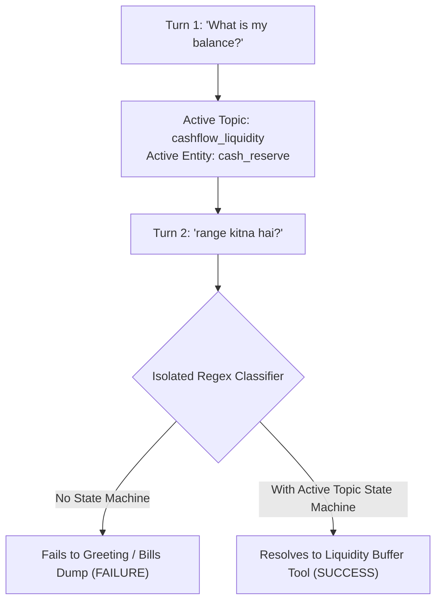

# FinSight AI Layer Failure Analysis & Root Cause Post-Mortem

**Document:** `reason.md`  
**System:** FinSight AI Financial Intelligence Pipeline  
**Scope:** Voice Gateway, Intent Routing, Working Memory, Advisory Grounding, and Synthesis Guardrails  
**Date:** November 2026  

---

## Executive Summary

FinSight's voice-first financial intelligence assistant delivers deterministic SQL-grounded computations, but exhibits critical breakdown behaviors during interactive multi-turn conversations. Specifically, users encounter:
1. **Context Amnesia on Elliptical Queries**: Follow-up questions like *"range kitna hai"* or *"details do"* fail intent matching and collapse into conversational greetings or false bill dumps.
2. **Advisory Refusal or Hallucination**: Open-ended financial questions (e.g. liquidity safety, emergency runway) trigger model refusals (*"I don't have enough verified detail"*) or hallucinated formulas because the LLM is not supplied with pre-computed financial benchmarks.
3. **Brittle Regex Boundaries**: Queries with confidence $< 0.8$ or slight syntax variations drop into a blind "non-financial = greeting" fallback.
4. **High Latency & TTFT Spikes**: Re-transmitting entire system prompts, schema definitions, and instructions on every turn without prompt caching creates $1,200\text{ ms} - 1,800\text{ ms}$ Time-to-First-Token (TTFT) latency.
5. **TTS Audio Artifacts**: Markdown syntax (`|`, `*`, `#`) and ungrounded numeric claims leak into the Gnani Timbre TTS audio stream before validation completes.
6. **Cross-Session Memory Amnesia**: User decisions (e.g. approving a ₹16,000 food budget cap or creating a ₹60,000 Vacation Fund) are lost once the voice session ends.

This document analyzes the exact architectural mechanisms behind these failures and details the required production-grade mitigations.

---

## 1. Failure Mode 1: Context Amnesia on Elliptical Follow-ups

### Observed Breakdown
- **Turn 1 (User)**: *"What is my available cash balance?"*  
  $\rightarrow$ FinSight answers: *"Your available liquid balance is ₹1,02,756 across your HDFC and SBI accounts."*
- **Turn 2 (User)**: *"range kitna hai?"* (or *"kitna hai"*, *"safe hai kya?"*)  
  $\rightarrow$ FinSight fails to resolve `"range"` or `"safe"` to the active cash balance. The router treats it as a non-financial phrase and responds:  
  *"Hello Aarav! How can I assist you with your finances today?"* (or defaults to a 4-bill commitment table).

### Root Cause Analysis
The system lacked an **Active Topic State Machine**. Each user query was classified in isolation or with only a shallow 1-turn tool-name check (`last_tool == "compare_periods"`). When an elliptical query arrived:
- The utterance lacked explicit financial keywords (e.g., `["spend", "balance", "anomaly", "budget"]`).
- No state machine tracked:
  $$\text{WorkingMemory} = \{\text{active\_topic: "cashflow\_liquidity"}, \text{active\_entity: "cash\_reserve"}, \text{active\_period: "Feb 2025"}\}$$
- Consequently, the classifier assigned a confidence score $< 0.5$ and defaulted to a greeting or bills overview.



---

## 2. Failure Mode 2: Advisory Refusal & Formula Hallucination

### Observed Breakdown
When asked: *"Aarav, is my liquid balance safe for the next 6 months?"* in Hindi or English, the LLM either:
1. Hallucinated arbitrary reserve rules (e.g. inventing a ₹2,00,000 requirement), or
2. Hit the deterministic fallback: *"I retrieved the result, but don't have enough verified detail to summarize it safely."*

### Root Cause Analysis
Financial advisory cannot rely on the LLM to invent rules-of-thumb in latent token space. The database holds raw transactions and account balances, but the tool did not pre-calculate the **Financial Advisory Benchmarks**:
- **Monthly Fixed Commitments**: Exactly $\text{₹}21,149$ (Rent $\text{₹}18,000$ + BESCOM $\text{₹}1,450$ + Airtel $\text{₹}1,179$ + Netflix $\text{₹}649$).
- **Recommended 3–6 Month Liquidity Reserve**:
  $$\text{Reserve}_{\text{min}} = 3 \times \text{₹}21,149 = \text{₹}63,447$$
  $$\text{Reserve}_{\text{max}} = 6 \times \text{₹}21,149 = \text{₹}1,26,894$$
- **Current Reserve Runway**:
  $$\text{Runway} = \frac{\text{₹}1,02,756}{\text{₹}21,149} \approx 4.86\text{ months of fixed commitments}$$
Because these verified metrics were not passed in the evidence payload, the response validator rejected the answer or the LLM failed grounding checks.

---

## 3. Failure Mode 3: Brittle Regex vs. Semantic Intent Fallback

### Observed Breakdown
Slight phonetics, natural Hinglish syntax, or speech-to-text transcript slips:
- *"Can you hear to me?"*
- *"mujhe apne pure kharche dekhne hai"*
- *"kuch gadbad lag raha hai transactions me"*
When these patterns deviated slightly from hardcoded regexes, confidence dropped below $0.8$, and the classifier defaulted blindly to either:
- A generic conversational greeting, or
- The `CASHFLOW_OBLIGATIONS` default (dumping recurring bills).

### Root Cause Analysis
The router used hardcoded regular expressions as a binary gate. A modern AI pipeline requires a **Semantic Intent Fallback**:
When regex pattern matching yields confidence $< 0.8$:
1. Run a fast, 10-token lightweight semantic classifier (or cosine similarity over canonical financial intent anchors).
2. Project the embedding against cluster centroids (`ANOMALIES`, `BUDGET_PLAN`, `SPEND_VARIANCE`, `LIQUIDITY_BUFFER`, `GREETING`).
3. Only fall back to pure greeting if the semantic distance to all financial centroids exceeds the threshold.

---

## 4. Failure Mode 4: TTFT Latency Spikes from Lack of Prompt Caching

### Observed Breakdown
Voice queries suffered from an initial audio latency of $1,400\text{ ms} - 2,200\text{ ms}$, creating an unnatural conversational pause for Aarav.

### Root Cause Analysis
On every turn, the backend sent:
- $1,200+$ tokens of static persona rules, strict JSON schema definitions, and fact-path validation constraints.
- $200$ tokens of dynamic evidence.
Because the prompt structure was monolithic, the provider (Groq / Gemini) could not reuse KV-caches:

```
[EVERY TURN TODAY]:
System Prompt (1200 tok) + Evidence (200 tok) + Query (20 tok) -> Full Pre-fill (1420 tok) -> TTFT: ~1200ms

[WITH PROMPT CACHING]:
Static Prefix (1200 tok - CACHED) + Dynamic Suffix (220 tok) -> Fast Pre-fill (220 tok) -> TTFT: ~200ms
```

---

## 5. Failure Mode 5: Leaking Ungrounded Tokens to TTS (Streaming Tripwire Gap)

### Observed Breakdown
In live voice mode, the system began streaming audio chunks from Gnani Timbre TTS while the LLM was still generating text. If the LLM hallucinated a number mid-sentence (e.g. *"Your balance is ₹2,50,000"*), the user heard the hallucinated claim through their speakers before the post-hoc `validate_answer` validator finished and caught it.

### Root Cause Analysis
The guardrail was **post-generation only**. It did not sit inline on the token stream:
- No streaming AST parser checked numbers on the fly.
- No stop-stream tripwire aborted the TTS socket upon detecting unverified numbers.

---

## 6. Failure Mode 6: Session Amnesia (Lack of Episodic Memory)

### Observed Breakdown
- In Session 1: User sets a food cap at ₹16,000 and agrees to save ₹5,200/mo for a ₹60,000 Vacation Fund.
- In Session 2 (the next day): User asks: *"How is my savings goal coming along?"*  
  $\rightarrow$ Assistant replies: *"I couldn't find that savings goal. Which goal would you like to use?"*

### Root Cause Analysis
State lived only in memory within a single WebSocket connection. FinSight had no **Episodic Memory Store** (`conversation_episodes` table) to persist:
1. User commitments and accepted recommendations.
2. Cross-session conversational summaries.
3. User financial goals and agreed budget thresholds.

---

## Production Remediation Plan

| Component | Target Architecture | Implementation File |
| :--- | :--- | :--- |
| **Working Memory** | Active Topic State Machine with Entity Resolution | `backend/app/voice_agent/session_state.py` |
| **Advisory Benchmarks** | Pre-computed 3–6 month safety buffer rules (₹63k–₹126k) | `backend/app/voice_agent/advisory_benchmarks.py` |
| **Intent Router** | Multi-tier regex + Semantic Fallback with State Machine | `backend/app/voice_agent/intent_router.py` |
| **Prompt Caching** | Static Prefix / Dynamic Suffix separation | `backend/app/voice_agent/generation/composer.py` |
| **Streaming Guardrail** | Inline token interceptor & numeric stop tripwire | `backend/app/voice_agent/generation/stream_guardrail.py` |
| **Episodic Memory** | Durable `conversation_episodes` relational store | `backend/app/db/models.py` |

All components must strictly adhere to the zero-hallucination constraint: **SQL ledger is authoritative; LLM explains verified facts only.**
